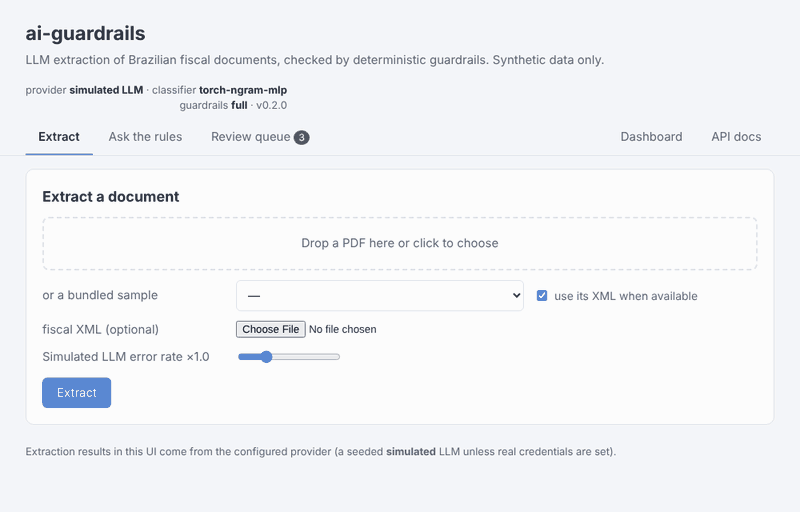
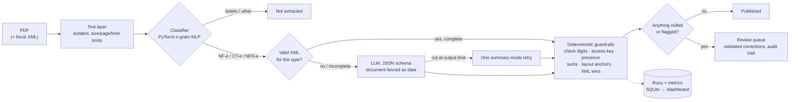
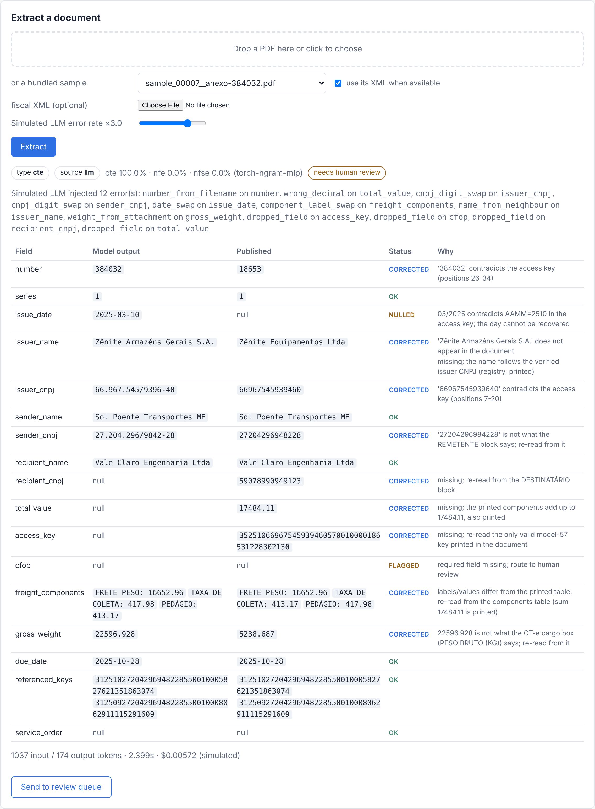
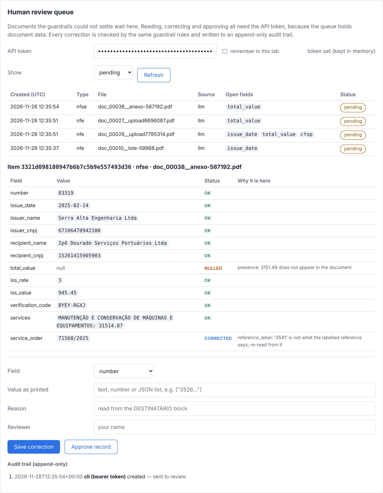
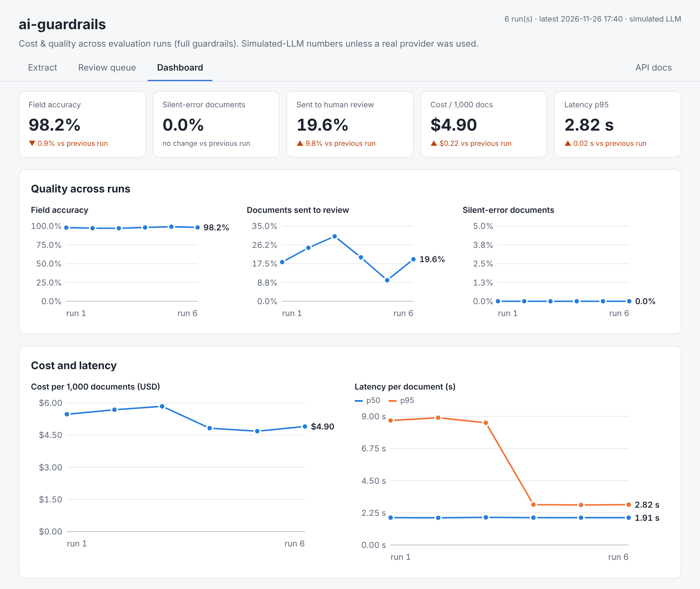

# ai-guardrails

**LLM extraction of Brazilian fiscal documents (NF-e, CT-e, NFS-e) with deterministic guardrails that catch what the model invents, a human review queue for what they cannot fix, and an evaluation harness that measures both.**

[](https://github.com/asoseihou/ai-guardrails/actions/workflows/ci.yml)
[](https://github.com/asoseihou/ai-guardrails/actions/workflows/codeql.yml)
[-95%25-brightgreen.svg)](Makefile)
[](LICENSE)
[](pyproject.toml)

LLMs read invoices well. Now and then they also **invent the fields that matter most**: a valid CNPJ copied from the wrong box, an invoice number taken from the file name, a gross weight read from an attached DANFE, a service-order number taken from a street address. The output is well-formed and plausible, so nothing downstream notices, and `temperature=0` does not help: for a given input the mistake is reproducible. This project keeps the defenses **outside the model**, in arithmetic and layout checks that are cheap, explainable and testable, and measures what they buy.

Everything runs **offline with no API keys**: synthetic documents and XML, a seeded simulated LLM, the guardrails, eval and replay, a BM25 RAG module, a PyTorch document classifier, a FastAPI service with a web UI, review queue and dashboard, an MCP server, Docker and CI. Real providers (Anthropic, Gemini, AWS Bedrock) plug in when credentials exist.



## How it works in 60 seconds



1. **Route.** A small classifier picks the document type; a bank slip (boleto) is never treated as an invoice, even when it carries the same amount.
2. **XML first.** When the document ships with its fiscal XML, the XML is the source of truth (parsed with `defusedxml`) and the LLM only fills fields the XML lacks.
3. **Extract.** Otherwise the LLM gets per-type anchors ("weight only from the CT-e cargo box") and the document text fenced as untrusted data. A truncated answer gets exactly one compact retry, then goes to review.
4. **Guard.** Every value must survive deterministic checks. A wrong value is **corrected only with proof** (the verified access key, the XML, or a unique self-consistent re-read of the box that owns it); anything else is **nulled and sent to review**. Every action is a structured finding.
5. **Review and measure.** Reviewers fix what was withheld; corrections must pass the same rules. Every evaluation run is stored and charted.

## Results

Regenerated by `make demo` (about 20 seconds on a 4-core CPU from a clean checkout) from [`reports/eval_report.md`](reports/eval_report.md), which also has the per-error-mode, per-field, replay, classifier and RAG tables.

<!-- RESULTS:START -->
| Metric | No guardrails | Check digits (v1) | + presence & consistency (v2) | + layout anchors & registry (v3) |
|---|---|---|---|---|
| Field accuracy | 89.0% | 89.0% | 92.4% | 97.9% |
| Straight-through documents (all fields right, no review) | 43.1% | 43.1% | 54.2% | 81.8% |
| Documents sent to human review | 3.1% | 41.3% | 43.6% | 18.2% |
| **Silent-error documents** (wrong data, no review) | **53.8%** (121) | **15.6%** (35) | **2.2%** (5) | **0.0%** (0) |
| Wrong values published | 165 | 49 | 6 | 0 |
| Fields corrected / nulled / flagged | 0 / 0 / 0 | 0 / 41 / 150 | 99 / 70 / 107 | 257 / 18 / 43 |
| False corrections (a correct value changed) | 0 | 0 | 0 | 0 |

Extraction rows: 225 extractable documents (NF-e, CT-e, NFS-e) out of 300 synthetic PDFs, seeded **simulated LLM** (seed 7).

| Other components | Result |
|---|---|
| Document-type classifier, test accuracy (full text / short noisy fragments) | 100.0% / 97.1% |
| RAG retrieval on 20 questions (hit@1 / hit@3 / MRR) | 85.0% / 100.0% / 0.917 |
| XML-first vs LLM-only on the 80 documents with an XML (field accuracy · LLM calls) | 100.0% · 41 vs 96.0% · 80 |
| Truncated answers recovered by one summary-mode retry (rest sent to review) | 7 of 14 · $0.3726 saved vs a 3-retry loop |
| Estimated cost per 1,000 documents (illustrative pricing, simulated tokens) | $5.47 |
<!-- RESULTS:END -->

> **Read this before quoting the numbers.** The extraction rows come from a **seeded simulated LLM**: the ground truth of each synthetic document with realistic error modes injected at fixed, deliberately high rates (`ErrorRates` in [`simulated.py`](src/docai/extract/providers/simulated.py)). They measure **what the guardrails do with those errors**, not how accurate any real model is. The synthetic layouts are regular, so the layout anchors (v3) work better here than they would on documents from hundreds of issuers; on an unknown layout an anchor does nothing and the v2 checks still apply. Costs use illustrative prices and token counts estimated from characters. To benchmark a real model on the same corpus, see [Real providers](#real-providers).

What the table says: without guardrails, more than half of the documents would be published with at least one wrong field and **nobody would be told**. Check digits alone catch impossible values but not a valid CNPJ from the wrong box. Presence and consistency checks remove most silent errors; layout anchors fix the rest **from the document itself**, which is why straight-through goes up while review goes down. **No correct value was changed** at any level, and every rule change is replayed for regressions before it ships.

| Extract | Review queue | Dashboard |
|---|---|---|
| [](docs/img/extract.png) | [](docs/img/review.png) | [](docs/img/dashboard.png) |

## Quickstart

```bash
git clone https://github.com/asoseihou/ai-guardrails.git && cd ai-guardrails
make install        # .venv from the hash-pinned lock + CPU PyTorch + the package
make demo           # offline: 300 synthetic PDFs, train, evaluate, write reports/ and this table
make check          # ruff, mypy --strict, tests + coverage gate, bandit, pip-audit
make serve          # API, web UI, review queue and dashboard on http://127.0.0.1:8000

export DOCAI_API_TOKEN=$(python -c "import secrets; print(secrets.token_urlsafe(32))")
docker compose up --build    # same API in a read-only, non-root container on 127.0.0.1:8000
```

Other commands (`python -m docai --help` for all options):

```bash
python -m docai synth --n 300 --out data/       # synthetic PDFs, XML and ground truth
python -m docai eval                            # off / dv-only / text / full -> reports/
python -m docai replay --a text --b full        # blast radius between two guardrail configs
python -m docai review enqueue samples/*.pdf    # queue documents that need a human
python -m docai ask "Which positions of the access key hold the issuer CNPJ?"
python -m docai validate 11.222.333/0001-81     # or a 44-digit access key
```

## API

| Endpoint | Auth | |
|---|---|---|
| `GET /health` | — | version, provider, classifier, guardrail preset |
| `POST /extract` | — (rate limited) | multipart `file` (PDF) and optional `xml` → type, raw output, published record, field status, findings, usage |
| `POST /ask` | — (rate limited) | `{"question": ...}` → cited answer from the fiscal-rules notes |
| `GET /review/items`, `GET /review/items/{id}` | bearer token (`DOCAI_REVIEW_PUBLIC_READ=true` opens reads for a demo) | review queue and audit trail |
| `POST /review/items` | bearer token | run a PDF (+ XML) through the pipeline; queued (201) only if it needs a human |
| `POST /review/items/{id}/corrections` | bearer token | correct one field; 422 with the reasons unless the value passes the guardrail rules |
| `POST /review/items/{id}/approve` | bearer token | approve once every required field has a value |
| `GET /metrics/runs` | — | stored evaluation runs (quality, cost, latency) |
| `GET /`, `/dashboard`, `/docs` | — | web UI, cost & quality dashboard, OpenAPI docs |

The review endpoints, reads included, compare `Authorization: Bearer <DOCAI_API_TOKEN>` in constant time and answer **503** when no token is configured. Paste the token in the Review tab of the web UI. Every response carries `X-Request-ID` and strict security headers; errors are generic and never echo input.

## Security

Uploads are size-limited while streaming (413 before the body is read), parsed in a killable child process with page, text and CPU limits, and rejected with 422 when encrypted or malformed; XML goes through `defusedxml`. The MCP tools only read files inside one sandbox folder. Logs carry the request id and a short document hash, never keys or document content. Prompt injection is mitigated by fencing and by the guardrails, not eliminated. The image is pinned by digest and runs non-root on a read-only filesystem; CI pins every action to a commit SHA and runs CodeQL, bandit and pip-audit. Threat model, residual risks and deployment guidance: [SECURITY.md](SECURITY.md).

## Configuration

All settings live in one typed `Settings` object (`src/docai/settings.py`), read from `DOCAI_*` environment variables. The ones you are most likely to change:

| Variable | Default | |
|---|---|---|
| `DOCAI_PROVIDER` | `simulated` | `anthropic`, `gemini`, `bedrock` or `auto` (first one with credentials and a model id) |
| `DOCAI_GUARDRAILS` | `full` | `off`, `dv-only`, `text`, `full` |
| `DOCAI_XML_FIRST` | `true` | use the fiscal XML instead of the LLM when it is present and complete |
| `DOCAI_API_TOKEN` | unset | bearer token (≥ 24 chars) for the review queue |
| `DOCAI_REVIEW_PUBLIC_READ` | `false` | `true` lets anyone read the queue; only for a demo with synthetic documents |
| `DOCAI_MAX_UPLOAD_BYTES` / `DOCAI_MAX_PDF_PAGES` | 10 MiB / 20 | input limits |
| `DOCAI_RATE_LIMIT_PER_MINUTE` | 30 | per client, POST only; `0` disables |
| `DOCAI_CORS_ORIGINS` | none | comma-separated explicit origins; `*` is rejected |
| `DOCAI_DB_PATH` | `var/docai.db` | SQLite file for the review queue and run history |

### Real providers

```bash
pip install -e ".[anthropic]"          # or ".[gemini]" / ".[bedrock]"
export ANTHROPIC_API_KEY=... DOCAI_ANTHROPIC_MODEL=...  # or GEMINI_API_KEY, or AWS credentials + DOCAI_BEDROCK_MODEL_ID
python -m docai eval --provider anthropic --limit 50
```

| Provider | Structured output | Default model (override with env) |
|---|---|---|
| `anthropic` | Messages API, forced tool call with the JSON schema | required: `DOCAI_ANTHROPIC_MODEL` |
| `gemini` | `google-genai`, `response_json_schema` | `gemini-2.5-flash` (`DOCAI_GEMINI_MODEL`) |
| `bedrock` | Converse API, forced tool call | required: `DOCAI_BEDROCK_MODEL_ID` |

Providers are optional extras, imported lazily and mocked in tests. Real calls cost money.

### MCP server

`python -m docai mcp` serves four tools over stdio: `validate_cnpj`, `validate_access_key`, `extract_document` (PDF and optional XML, only inside `DOCAI_MCP_ROOT`) and `search_fiscal_rules`.

```json
{ "mcpServers": { "docai": { "command": "python", "args": ["-m", "docai", "mcp"], "cwd": "/path/to/ai-guardrails" } } }
```

## Documentation

| | |
|---|---|
| [docs/processing-guide.md](docs/processing-guide.md) | How each document type is read: steps, fields, anchors and the guardrails behind them |
| [docs/ARCHITECTURE.md](docs/ARCHITECTURE.md) | Components, the `/extract` sequence, data flow, layering rules, extension points |
| [docs/adr/](docs/adr/) | Decision records: guardrails outside the model, never invent, XML-first, BM25, SQLite |
| [docs/PLAN.md](docs/PLAN.md) | Delivered vs planned, roadmap milestones with acceptance criteria |
| [SECURITY.md](SECURITY.md) · [CONTRIBUTING.md](CONTRIBUTING.md) · [CHANGELOG.md](CHANGELOG.md) | |

## Known limitations

- **Simulated numbers.** See the note under [Results](#results). A real-provider benchmark is the first roadmap milestone.
- **Text layer required.** Presence checks and anchors read the PDF's text layer; scanned documents need OCR first (planned).
- **One document per PDF.** Splitting a multi-document PDF into segments is not implemented; attached pages (for example a DANFE after a DACTE) are handled by reading only the main page.
- **The day of issue cannot be recovered** from the access key (only year and month), so a wrong date is nulled, not corrected.
- **Single shared token.** The review queue records the reviewer name the client sends; there is no per-user authentication.

## About

Inspired by production document-AI work. This repository uses only synthetic data (invented company names, CNPJs with valid check digits in branch numbers registered establishments practically never use, and a *SEM VALOR FISCAL* banner on every PDF) and contains no employer code.

Licensed under the [MIT License](LICENSE).
