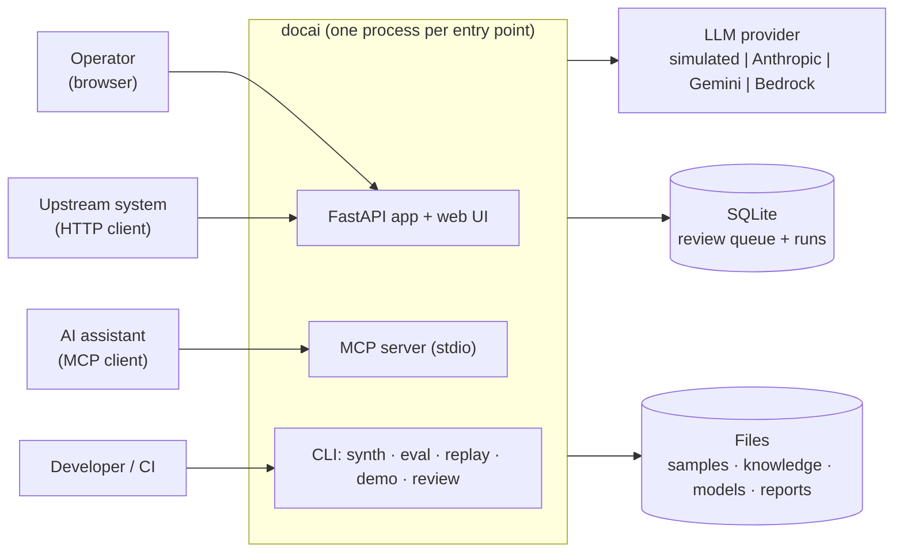
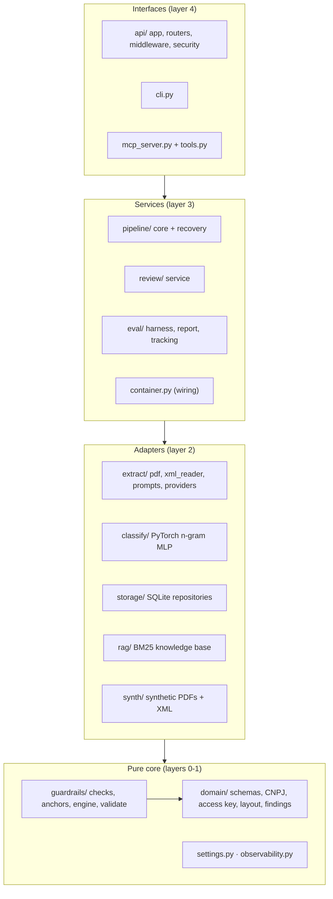
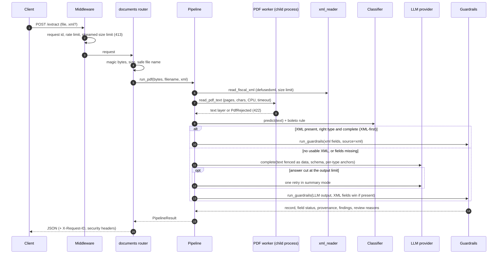

# Architecture

## Context

ai-guardrails turns a fiscal document (a PDF, optionally with its XML) into a validated record or a review task. It is a single Python package (`docai`) with four entry points that share one service layer: an HTTP API with a static web UI, a CLI, an MCP server and the evaluation harness.

Only the LLM call leaves the machine, and only when a real provider is configured. The default provider is a seeded simulator, so everything else, including CI, runs offline.

## Components

## The `/extract` request

An answer that is still truncated after the retry does not raise: the guardrails still run on what the XML and the document give, and the result carries a review reason, so the failure is visible and never silent. A provider error (network, quota, refusal) becomes a generic 502 with the request id.

## Data flow

| Data | Where it lives | Lifetime |
|---|---|---|
| Uploaded PDF / XML bytes | memory of the request; the PDF is piped to the worker's stdin | the request |
| Text layer | memory; stored in `review_items` only when the document is queued | until the item is deleted |
| Extraction result, findings | response body; `review_items` when queued | as above |
| Review actions | `review_audit`, append-only (triggers reject UPDATE and DELETE) | permanent |
| Evaluation runs (metrics, cost, latency) | `runs` | permanent |
| Logs | stdout (text or JSON), with request id and a 12-character SHA-256 prefix of the document | your log pipeline |

Nothing is written to disk by `/extract` itself. The database path is `DOCAI_DB_PATH` (default `var/docai.db`); the container mounts it on a volume because the root filesystem is read-only.

## Module responsibilities

| Module | Responsibility |
|---|---|
| `domain/` | Pure value logic: document types, field schemas and kinds, normalization, CNPJ and access-key arithmetic, layout readers (role blocks, labelled references, CT-e cargo box, services table), findings and provenance. No I/O. |
| `guardrails/` | The checks (`checks.py`, `anchors.py`), the ordered runner and presets (`engine.py`), and the reviewer-correction validator (`validate.py`). Pure: input record + text in, result out. |
| `settings.py` | One frozen, typed `Settings` read from `DOCAI_*` variables; secrets are `SecretStr`. |
| `observability.py` | Logging setup, request-id context variable, short document hash. |
| `extract/` | Untrusted-input readers (`pdf.py` with the isolated worker, `xml_reader.py`), prompts and the fence, the heuristic baseline, and LLM providers behind `LLMProvider.complete`. |
| `classify/` | Document-type classifier (PyTorch) with a keyword fallback when no model is trained. |
| `storage/` | SQLite connection, schema, `ReviewRepository` and `RunRepository`. Parameterized SQL only. |
| `rag/` | Markdown chunking, BM25 search and cited extractive answers over `knowledge/`. |
| `synth/` | Synthetic DANFE, DACTE, NFS-e, boleto and "other" PDFs, their XML and ground truth. |
| `pipeline/` | Routing, the XML-first decision (`guard`, the only place that policy lives), truncation recovery. |
| `review/` | Queue rules: enqueue only what needs review, cap on pending items, validated corrections, approval. |
| `eval/` | Corpus extraction, metrics per guardrail level, replay (blast radius), reports, run records. |
| `container.py` | Builds and caches the shared objects from `Settings` (pipeline, provider, classifier, repositories). |
| `api/`, `cli.py`, `mcp_server.py`, `tools.py` | Interfaces. No business rules; they validate input, call services and shape output. |

## Layering rules

Enforced by `tests/test_architecture.py`, which parses every import (including imports inside functions):

1. A module imports only from its own layer or below: domain (0) → guardrails, settings, observability (1) → adapters (2) → services (3) → interfaces (4).
2. `domain` imports nothing from `docai`; `guardrails` imports only `domain`; `settings` and `observability` import nothing from `docai`.
3. Adapters do not import each other, except `extract → synth` (the simulated LLM reuses the synthetic-data helpers).
4. Configuration is read in one place: modules receive values from `Settings` (through `container.py` or arguments) instead of reading the environment.

The consequence that matters: the guardrails can be tested, replayed and reused without a web server, a database or a model.

## Extension points

| To add | Do this |
|---|---|
| An LLM provider | Implement `LLMProvider.complete(text, schema, context, variant)` returning an `ExtractionResult` with `finish_reason` and `usage`; register it in `extract/providers/__init__.py`. Map the provider's stop reason to `FinishReason` so truncation recovery works. |
| A guardrail check | Write `check_x(state)` in `guardrails/checks.py` or `anchors.py` (pure; record a `Finding` for every change), add it to `_steps` in `engine.py` behind a config flag, then run `python -m docai replay` and ship only with zero regressions. |
| A field | Add it to the type's schema in `domain/schemas.py` with an anchored description and a kind (normalizer + presence rule), to the per-type rules in `extract/prompts.py`, and to the generator if it should be evaluated. |
| A document type | Extend `domain/doc_types.py`, the schema, the prompts, the generator and the classifier labels; the eval picks it up from the corpus. |
| A retriever | Keep `KnowledgeBase.search(question, k) -> list[Passage]`; swap BM25 for an embedding index behind it (see ADR 0004). |
| A storage backend | Reimplement `ReviewRepository` / `RunRepository`; keep the audit trail append-only. |
